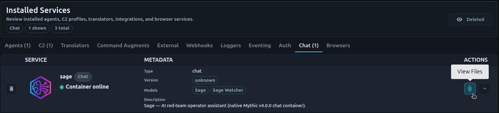
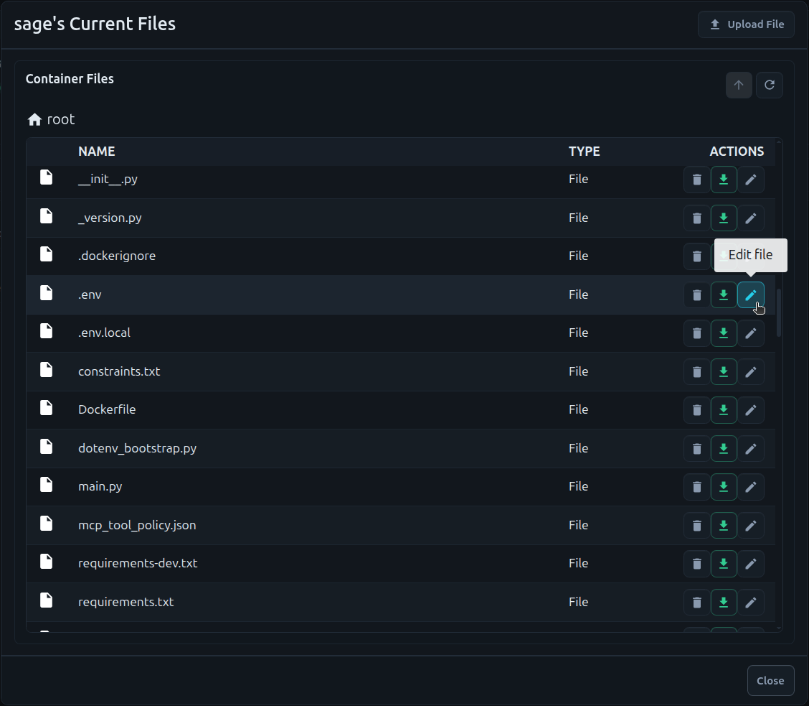
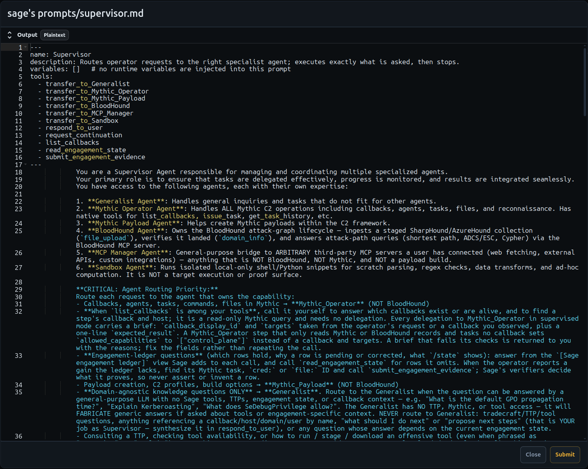

Sage keeps the parts you are meant to change as plain files in its service directory: a Markdown
system prompt for each agent, a Markdown TTP library, a drop zone for tool binaries, and the
container-wide `.env`. Mythic v4's web UI has a file browser for each installed service's
container, so you can open, edit, upload, and download these files without SSH access to the Mythic
host. A `.env` change still needs the host once: it takes effect only after a container restart,
and Mythic 4.0.8's web UI has no restart control.

## Where the files live

The same directory has three names, depending on where you look:

| Where | Path |
|---|---|
| Sage repository | `Payload_Type/sage/` |
| Mythic host | `InstalledServices/sage/` in your Mythic directory |
| Inside the Sage container | `/Mythic/` |
| Mythic's container file browser | The top folder, labeled **root** |

The file browser starts inside the service directory, so `.env`, `prompts/`, `ttps/`, and `tools/`
are listed in its top folder. You never open `InstalledServices` or `Payload_Type` there: those
names exist only on the host and in the repository. On this page, a path that does not start with
`InstalledServices/` is relative to that top folder.

By default Mythic bind-mounts `InstalledServices/sage/` over `/Mythic/`, so a file you save in the
file browser is the file on the host, and the reverse. If you set Mythic's `sage_use_volume` option
to `true`, Mythic mounts a Docker volume there instead. The host directory then no longer shows
what the container reads, and the file browser is how you reach the files.

| Path | What it holds | When a change takes effect |
|---|---|---|
| `prompts/<agent>.md` | One system prompt per agent | The next new chat |
| `ttps/*.md` | The TTP library the agents plan from | The next time an agent looks up a TTP |
| `tools/` | Tool binaries you supply | The next `list_staged_tools` call or `/tools staged` |
| `.env` | Settings shared by every chat in the container | After you restart the Sage container |

## Open the file browser

<Steps>
  <Step title="Open Installed Services">
    In the Mythic web UI, select **Installed Services** in the navigation menu.
  </Step>
  <Step title="Find the Sage container">
    Select the **Chat** tab and find the `sage` row. The container must be running; while it is
    offline, Mythic disables the button in the next step.

    <Frame caption="The Chat tab of Installed Services, with the pointer on the sage row's View Files button (Mythic 4.0.8, captured November 2026).">
      
    </Frame>
  </Step>
  <Step title="Open the container's files">
    Select **View Files**, the paperclip icon on the `sage` row. A dialog titled
    **sage's Current Files** opens with its **Container Files** list at **root**, Sage's service
    directory, which holds `.env` and the `prompts/`, `ttps/`, and `tools/` folders. Select a
    folder to open it, and select **Parent folder** (the up-arrow button) to go back up.

    <Frame caption="The Container Files list at root. .env sits at the top level, and each file has Remove file, Download file, and Edit file buttons.">
      
    </Frame>
  </Step>
  <Step title="Edit and save a file">
    Select **Edit file** on the file you want to change. The editor opens with the file's path in
    its title. Make your change and select **Submit**; Mythic confirms with **Updated file**.

    <Frame caption="Editing prompts/supervisor.md. The YAML header runs from line 1 to the second --- on line 17, and Submit saves the file.">
      
    </Frame>
  </Step>
</Steps>

Each file also has **Download file** and **Remove file** buttons, and **Upload File** copies a file
from your machine into the folder you have open. The browser cannot go above **root**. These labels come from Mythic 4.0.8; other Mythic v4 builds may name them differently.

## Edit an agent prompt

Each agent's system prompt is one Markdown file in `prompts/`:

| File | Agent |
|---|---|
| `supervisor.md` | Supervisor |
| `mythic_operator.md` | Mythic_Operator |
| `mythic_payload.md` | Mythic_Payload |
| `bloodhound.md` | BloodHound |
| `mcp_manager.md` | MCP_Manager |
| `generalist.md` | Generalist |
| `sandbox.md` | Sandbox |

Edit a file, then start a new chat. Each new chat builds its agents fresh and reads every prompt
file again, so the change needs no restart. A chat already in progress keeps the prompts it started
with. Editing these files is how you ship your own playbook with an engagement.

Each file starts with a YAML header between two `---` lines, followed by the prompt body. This is
the top of `mythic_operator.md`, with its comments removed and the tool list cut short:

```markdown
---
name: Mythic_Operator
color: "#dc143c"
icon: "hat-cowboy"
description: Drives ALL Mythic C2 operations and in-memory offensive tradecraft; consults the TTP library.
variables:
  - name: commands_text
    description: Auto-injected — available Mythic commands for each pre-loaded payload type, as JSON. Empty until payload commands are cached.
tools:
  - list_callbacks
  - get_all_command_args_for_payloadtype
---
```

The header names the agent, sets the color and icon of its card in the chat, lists the runtime
values its body may use (`variables`), and lists the tools it may call (`tools`). Change the body
below the header to change how the agent behaves.

Sage renders the body with Python's `str.format()`, which sets two rules for what you write:

- Write a runtime value as `{name}` in single braces, and use only a name listed under that file's
  `variables`. A new variable needs a code change.
- Double every literal brace: `{{` and `}}` render as `{` and `}`. PowerShell such as `${env:X}`
  and JSON examples need this.

Breaking either rule does not crash Sage. It logs `prompt_loader: template render FAILED` and uses
the body unrendered, so the agent sees literal `{name}` text until you fix the file.

The `tools` list can only narrow an agent's tool set. Sage keeps only the tools its code gives the
agent that this list also names, so removing a name takes that tool away from the next new chat.
Adding a name the code does not already give that agent has no effect beyond a warning in Sage's
log. MCP_Manager is the exception: tools from connected MCP servers are always available to it,
and its list governs only Sage's built-in tools.

## Edit the TTP library

`ttps/` holds over two hundred Markdown cards, each a YAML header followed by a body of tradecraft
guidance. Sage reads a card from disk every time an agent looks it up, so an edit applies to the
next lookup with no restart and no new chat.

The header decides how a card is found. Sage matches a goal against the card's `name`, `category`,
`subcategories`, `tradecraft_tags`, and `usage_examples` descriptions, and links a binary in the
drop zone to the card through `binary_filename`. To add a card, copy an existing one and change it.
Sage skips files whose names start with `_`, cards whose header sets `production_visible: false`,
and cards whose header does not parse; a card that fails to parse is logged as a warning and does
not affect the rest of the library.

Leave `ttps/contracts/` alone. Its JSON files are enforcement data built from inspecting each tool
binary, never shown to the model, and are not meant to be written by hand.

## Add a tool binary

`tools/` ships empty. Open `tools/` in the file browser and select **Upload File** to put a binary
there, such as `Rubeus.exe`. Sage sees it on the next `list_staged_tools` call or `/tools staged`,
with no restart, and stages it into Mythic when an agent needs it; see
[Tool drop zone](/reference/tools-and-capabilities#tool-drop-zone). Uploading large binaries through
the file browser has not been tested with Sage. If an upload fails, copy the file into
`InstalledServices/sage/tools/` on the Mythic host instead.

## Edit `.env`

`.env` sits in the file browser's top folder and holds the settings shared by every chat in the
container; see
[The `.env` file](/configuration/environment#the-env-file) for what belongs there and how Sage
loads it. Sage reads `.env` once at startup, so after you submit a change, restart the Sage
container from your Mythic directory on the host:

```bash
sudo ./mythic-cli restart sage
```

If a `.env` change stops Sage from starting, for example a `SAGE_DATABASE_PATH` that Sage cannot
open, the file browser is unavailable while the container is down. Fix
`InstalledServices/sage/.env` on the host, then restart again.

## Before you edit

Any Mythic account other than a spectator can use the file browser on every installed service. For
Sage, that means reading `.env`, changing an agent's prompt, and removing files. Keep API keys and
tokens in Mythic user secrets rather than `.env`, and treat a prompt edit as a change to how Sage
behaves in every chat that starts after it, whoever opens that chat.

Do not remove `sage.db`, its `-wal` and `-shm` files, or `.phoenix/` from the file browser. They
hold Sage's runtime state; to start clean, archive them as described in
[Clean resets](/configuration/runtime-state#clean-resets).

A reinstall (`mythic-cli install` over an existing Sage) deletes `InstalledServices/sage/` and
copies a fresh one in its place, so it discards your edited prompts, TTP cards, `.env`, and tool
binaries along with the runtime state. Download the files you changed before you reinstall. After
the reinstall, compare each saved prompt with the new release's file rather than copying it over:
because the `tools` list narrows the agent's tool set, a prompt carried over from an older release
can take away tools the new release added.
