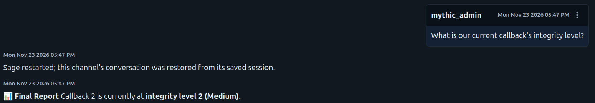

## What lives where

Under a Mythic install, all of these sit in the Sage service directory,
`InstalledServices/sage/`:

| Path | Contents | Override |
|---|---|---|
| `sage.db` | LangGraph checkpoints, tool cache, channel markers and the per-channel session records that let a chat [continue after a restart](#what-a-restart-does-to-your-chats), each chat's [coding-agent](/guides/coding-agent) profile and model selection, controller recovery, operation memory (including retained report observations), and the [Engagement State Ledger](/guides/engagement-ledger). Separate APIs on one physical SQLite file, with separate erasure lifecycles. | `SAGE_DATABASE_PATH` |
| `.phoenix/phoenix.db` | Observability (trace) history. See [Observability](/configuration/observability). | `PHOENIX_WORKING_DIR` |
| `.sage_engagement/` | Artifacts and decision records. Ledger JSON files from releases before the Engagement State Ledger moved into `sage.db` also sit here until you import them. | `SAGE_ENGAGEMENT_STATE_DIR` |

All three are retained trajectory data. The `sage.db` and Phoenix default paths are independent of
the process working directory; the `.sage_engagement/` directory is created in the working
directory of the Sage process, which under Mythic is the service directory.

## Importing a ledger from an earlier release

Earlier releases stored the ledger as `.sage_engagement/state_<operation>.json` files. While such a
file is present and not yet imported, Sage reports the Engagement State Ledger as unavailable and
names the file. Stop Sage, then run the import from the root of a Sage source checkout (the script
is not in the container image):

```bash
sudo ./mythic-cli stop sage
python3 skills/sage-goad-reset/scripts/engagement_ledger_migrate.py import --sage-stopped \
  --database <mythic dir>/InstalledServices/sage/sage.db \
  --legacy-dir <mythic dir>/InstalledServices/sage/.sage_engagement
sudo ./mythic-cli start sage
```

The import never modifies the source files, and a repeated import of the same file changes
nothing. A file whose name does not identify its operation needs `--map FILE=KEY`, or
`--exclude FILE` to record it as deliberately not imported.

## SQLite on macOS

If you run Mythic via Docker Desktop or OrbStack on macOS, the service directory that Mythic
bind-mounts into the Sage container goes through a file-sharing layer that does not support
SQLite's locking, and Sage reports `unable to open database file`.

Move both databases to a path inside the container. Add two lines to Sage's `.env`, then restart
the Sage container. In the Mythic UI's
[container file browser](/configuration/edit-files-from-mythic), `.env` is in the top folder. On
the Mythic host it is `InstalledServices/sage/.env`, and these commands, run from your Mythic
directory, append the lines there:

```bash
echo 'PHOENIX_WORKING_DIR=/opt/sage_data' | sudo tee -a InstalledServices/sage/.env
echo 'SAGE_DATABASE_PATH=/opt/sage_data/sage.db' | sudo tee -a InstalledServices/sage/.env
```

You must set both. Startup creates the directories, checks that `sage.db` can be opened and
locked, and stops with an error that names the path if it cannot. The databases survive a
container **restart** but are deleted when the container is **recreated** (by a rebuild or
reinstall).

## What a restart does to your chats

When Sage restarts with `sage.db` retained, an existing chat continues on its next request. Sage
rebuilds the session from the channel's saved record and its checkpoint, with its conversation,
`/mode` override, and engagement binding, and posts this line in the channel:

```text
Sage restarted; this channel's conversation was restored from its saved session.
```

<Frame caption="The first message a chat received after a Sage restart. Sage posts the restored notice as its own message, then answers.">
  
</Frame>

Nothing that grants authority carries over. The request's current Mythic identity and chat
configuration must match what the session was saved under, and secrets are resolved again. A
pending approval card still resolves only by an exact decision on that card.

### Requests a restart left open

A restart leaves the request Sage was answering open in Mythic, and Mythic accepts no new prompt in
that channel until the request ends. When Mythic sends the Sage container its startup message,
Sage settles each open request without a model call or a Mythic task:

| The open request had | What Sage does |
|---|---|
| An approval card still waiting | Leaves it open for your decision. |
| An approval card you already decided, while Sage was down or starting | Adds one **Continue saved decision / Stop** card to the same request and applies nothing yet. |
| A card saved by a Sage version from before request state was kept | Closes it with a notice. The action is not run. |
| Anything else | Closes the request with a notice. Nothing from it is resent. |

Sage cannot tell whether Mythic will still deliver a decision you made while it was down, so the
Continue/Stop card waits for one of these to happen:

- If Mythic delivers your original decision, Sage applies it once and retires the Continue/Stop card.
- **Continue** applies the saved decision exactly as you made it: an approval runs the action once,
  and a rejection runs nothing. Continue never changes the decision.
- **Stop**, or Cancel on the request in Mythic, discards the saved decision.

Before it applies a saved decision, Sage checks it again against the card, the session's identity
and configuration, and the paused action. If any of them changed, including the chat's mode or tool
access (for example after a later `/mode` change), nothing runs and the request closes with the
reason. An approved action that still does not run after the restart ends its request as an error,
not a completion. A resumed request keeps its original tool and sub-agent cards, its step budget,
and its in-request denials, and ends normally.

Sage never resends an approved action the restart interrupted. Your next message gets the exact
Mythic task it produced, or says that its outcome is unknown; in that case, check the task list in
Mythic before you ask for the same action again.

Mythic sends the startup message only to an operation that has an active bot account assigned to
it. Without one, the open request stays open: use Cancel on it in Mythic to free the channel.

A restart never restarts autonomous work, and an approval owned by the autonomous controller is not
resumed. Coding-agent connections do not reconnect on their own either: a chat shows `disconnected`
until you run `/acp connect codex` again (see [Connect a coding agent](/guides/coding-agent)).

### When a chat still needs a fresh channel

Start a new chat when Sage says so. It names the reason, which is one of these:

- the session ended on purpose: stop, cancel, an error, or a changed configuration or API token;
- the chat's saved state cannot be read;
- a chat from before restorable sessions cannot be matched to exactly one saved conversation.

Archiving or deleting `sage.db` (see [Clean resets](#clean-resets)) removes every saved session, so
each existing chat needs a fresh channel afterward. The Engagement State Ledger is unaffected by a
restart, and read-only `/state`, `/report`, and tool discovery work either way.

## Clean resets

Never delete runtime state to obtain a clean run. Archive it instead, so the history stays
available. From your Mythic directory, stop Sage, then move the active state aside under a
timestamp:

```bash
sudo ./mythic-cli stop sage
cd InstalledServices/sage
ts=$(date +%Y%m%dT%H%M%S); mkdir -p archive/$ts
mv sage.db* .phoenix .sage_engagement archive/$ts/ 2>/dev/null
cd ../.. && sudo ./mythic-cli start sage
```

Move `sage.db` together with its `-wal` and `-shm` sidecars (the `sage.db*` glob does this), or
uncheckpointed writes are lost. If you redirected any path with the overrides above, archive from
that location instead.

Sage v0.2.0 writes some of this state as root, so the `mv` may need `sudo`. From v0.3.0, the
container runs Sage as the owner of the service directory and hands earlier root-owned files back
on first start.

A reinstall replaces the whole service directory, so archive this state outside
`InstalledServices/sage/` before running `mythic-cli install` again. If you set up a
[coding agent](/guides/coding-agent), copy `container/codex/.env` and `.sage_acp/` out as well.

## Operation-memory erasure

An operation-memory wipe removes Sage-derived state for one operation but deliberately leaves
authoritative Mythic records unchanged. It does not erase separate LangGraph checkpoints, Phoenix
traces, LiteLLM or provider retention, native Mythic messages, or Slack workspace records; each
owner must apply its own retention policy.
