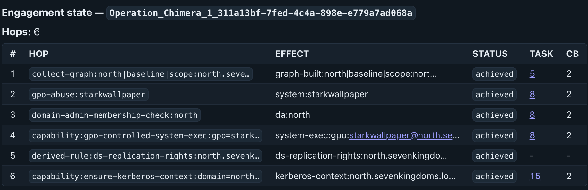

An LLM does not remember your operation between turns, so Sage keeps that memory outside the
model in the Engagement State Ledger: a durable table of the capabilities and credential material
the operation has gained, shared by every chat in the current Mythic operation. The concept and
the proof machinery are described in
[How Sage works](/understand/how-sage-works#the-engagement-state-ledger); this page is the
operator's guide to living with it.

## Reading and correcting with `/state`

- `/state` shows the ledger. Each row has a permanent number (the `#` column), its effect, its
  status (`achieved` or `pending`), the Mythic task behind it, and the callback.
- `/state remove <#>` retracts a row and records who, when, and why. `/state restore <#>` undoes
  the retraction, and `/state invalidate <#>` marks a row as no longer holding. A corrected row
  keeps its number and stays listed, but no gate, capability input, or completion check relies on
  it again.
- `/state wipe` retracts every row and every current graph fact without deleting or renumbering
  anything.
- `/state objective <text>` sets the operation's stored compatibility objective, an operation
  setting rather than a channel goal.
- `/state help` shows the usage without reading the ledger.

`/state` renders the ledger as a table in chat:

<Frame caption="/state in a Sage channel, showing the Engagement State Ledger with six achieved hops after a supervised run reached Domain Admin. The columns are #, Hop, Effect, Status, Task, and CB, and each achieved row names the Mythic task and callback that prove it.">
  
</Frame>

A `pending` row is waiting for its effect or its proof, and it never satisfies a capability's
precondition. No command marks a row `achieved` without verified evidence, so the ledger never
records your optimism as fact. The model is held to the same rule: it can read the ledger and
submit Mythic evidence IDs for verification, but it never writes rows.

## Recording completed task work

Not every gain starts as a Sage run. When a conversation or supervised turn ends, Sage reconciles
the operation's completed Mythic tasks from every callback and every issuer, and records what the
task, credential, and callback verifiers prove. Failed attempts stay in Mythic's task history.

To verify specific evidence yourself, cite Mythic task display IDs, credential IDs, or file IDs:

```text
/state reconcile <task id>,cred:<credential id>,file:<file id> [apply]
```

Verified rows are saved immediately. Credential material parsed from task output is imported into
Mythic's credential store only when you add `apply`, because task output is
attacker-influenceable: a compromised host can feed fake values into a task result, and without
`apply` you see a preview of the import before anything lands in the credential store.

`/state set` covers one narrow case: a pending account-secret row whose task completed with a
completion-function error after the agent answered. You cite where the secret sits in that task's
output; Sage checks the citation and promotes the row to credential material. It never takes the
secret itself, and a working credential still needs its own verified proof.

```text
/state set <#> achieved task=<task display id> type=<plaintext|cookie|ntlm|rc4|aes128|aes256> account=<account>@<realm> line=<output line> after=<text just before the value>
```

## Identity reporting

`/report` shows retained identity and membership observations shared across assisted chats in the
same operation engagement, unknown access prerequisites, and authored next checks. It uses
matched task observations Sage has collected; no model call for the report itself.

Two caveats apply: observations may be historical or incomplete, and a reported identity or host
membership does not prove current authentication or access.

## Persistence and restarts

The Engagement State Ledger persists once written. It lives in Sage's `sage.db` SQLite database,
keyed by the Mythic operation and the reset marker Sage stores in that operation, and it survives
Sage restarts. A supervised chat's conversational scope does not survive a restart. See
[Runtime state and resets](/configuration/runtime-state) for where state lives, what a restart
does to your chats, how to archive it, and how to import a ledger that an earlier release stored
as JSON.
