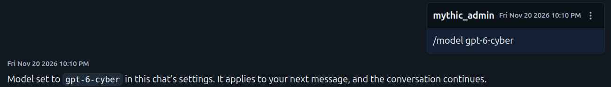

Every Sage chat calls one model through one provider. You choose both in the chat's configuration
(the pencil icon on the channel header), and you can change the model later without starting a new
chat. This page covers the provider choice, changing a model mid-engagement, the settings that
apply only to OpenAI, and what to do when the provider refuses a request.

Each setting on this page resolves in the same order: the chat's own field, then a Mythic user
secret of the same name where Sage declares one, then the container environment (Sage's `.env`).
The first non-empty value wins. [Environment and configuration](/configuration/environment#model-configuration) lists the
variable names, and [Chat channel configuration](/guides/chat-config) describes every field.

<Note>
  Support in code is not validation. Other providers, routes, and models than the ones in
  [Limitations and validated configuration](/understand/limitations#what-is-not-validated) are
  not validated. Record the provider and route you used for a run; never infer the backend from a
  model name.
</Note>

## Providers and routes

| Provider | What it uses |
|---|---|
| `openai` (the default, also used when **Provider** is blank) | **API Key** and **API Endpoint** |
| `bedrock` | The four AWS fields: access key ID, secret access key, session token, and region |
| `anthropic` | **API Key** and **API Endpoint** |
| `ollama` | **API Key** and **API Endpoint** |

These four are the tested set. Sage builds the model through LangChain's `init_chat_model`, so
other providers LangChain supports may work, but they are unverified.

The `openai` provider speaks the OpenAI API, which most inference servers and gateways implement.
Point **API Endpoint** at any server that exposes it: a self-hosted model, an internal gateway, or
a [LiteLLM](https://docs.litellm.ai/docs/simple_proxy) proxy in front of other providers. Through a
proxy, the proxy decides which API route and reasoning efforts reach the model. Sage sends what you
selected and does not infer a proxy's capabilities from a model name.

**OpenAI API**, **OpenAI Daybreak**, **OpenAI Safety Identifier**, and **Reasoning Effort** apply
to the `openai` provider only. A value for any of them on another provider fails before Sage sends
a request, and that includes a value inherited from a user secret or the container environment. Set
them in `.env` only when every chat in the container uses the `openai` provider.

## Change a chat's model

Change the model in any of three ways. Each one writes the same setting:

- Edit **Model** in the chat's configuration.
- Click the **Model** chip above the transcript, which runs `/model` after you confirm.
- Run `/model` with the new name in the channel:

```text
/model gpt-5.6-sol
```

`/model` on its own shows the chat's model and where the value comes from. The name is one value
with no spaces; Bedrock ARNs and Ollama tags are accepted. `/model <name>` writes the chat's
**Model** setting in Mythic through the channel's API token, so Mythic's own rules apply: Mythic
accepts the change only from the channel's creator or an operation lead or admin. The new model
applies to your next message.

<Frame caption="/model with a new name writes the chat's Model setting. The change applies to the next message, and the conversation continues.">
  
</Frame>

The next message continues the same conversation. Earlier messages, tool calls, and tool results go
to the new model. The previous model's opaque reasoning (OpenAI Responses reasoning items,
Anthropic thinking, Bedrock reasoning) is not sent to a different model.

If the provider rejects the new model before it has answered, issued a Mythic task, or raised an
approval, the chat stays as it was. The error names the provider, the model value and where it came
from, the provider's message, and the fix, so you correct the name in place and send again.

If an approval card, a saved decision, or a controller step is waiting when you change the model or
an OpenAI setting, Sage holds the change and runs nothing for that message. Answer or decline the
card first: the model that raised it applies your decision, and the change takes effect on your next
message after that. If Sage restarted while the card was waiting, set **Model** back to the model
the card names, then answer the card or choose Continue.

### Which changes keep the conversation

| You change | Result |
|---|---|
| **Model** (the setting, the chip, or `/model`) | The same chat continues with the new model |
| **OpenAI API**, **OpenAI Daybreak**, or **OpenAI Safety Identifier** | The same chat continues |
| **Reasoning Effort** | The same chat continues |
| Your OpenAI project (access, approvals, allowlists), with no Sage setting changed | Send again; Sage retries in the same chat |
| **API Key**, **Provider**, or **API Endpoint** | A new chat session starts, and the earlier conversation does not carry over |
| Any other chat setting, such as **Mode** or the BloodHound fields | A new chat session starts |

The changes that continue a chat do so on an idle chat, in the same Sage process or after a
restart. Sage never changes the model, provider, endpoint, API, or reasoning effort on its own.

## OpenAI Responses API

Some OpenAI models are served only on the Responses API, including OpenAI's -cyber models from
GPT-5.6 Cyber on. Several reasoning models also accept tools together with a reasoning effort only
on Responses; see [Reasoning effort with tools](#reasoning-effort-with-tools). Choose the route
with **OpenAI API**:

| Choice | Value | Effect |
|---|---|---|
| Use configured default | blank | Falls back to `SAGE_OPENAI_API`. With no value anywhere, the adapter keeps its usual route (Chat Completions for most models) and Sage adds no request fields |
| Chat Completions | `chat_completions` | Pins Chat Completions |
| Responses | `responses` | Uses the Responses API |

Keep **API Endpoint** as the base URL, for example `https://api.openai.com/v1`. Sage adds
`/responses` or `/chat/completions` itself.

Responses requests are stateless: Sage sends `store: false`, asks for the model's encrypted
reasoning, and sends it back with the conversation history it already keeps on every request.
[Security and data handling](/understand/security-and-data-handling#data-handling) lists what this
route sends and where it is retained. Sage 0.3.0 has no **OpenAI API** setting; if a chat's
configuration does not list it, upgrade Sage.

## OpenAI Daybreak

**OpenAI Daybreak** selects the [Daybreak](https://developers.openai.com/api/docs/guides/daybreak)
access program a Responses request names:

| Choice | Value | Sent |
|---|---|---|
| Use configured default | blank | `SAGE_OPENAI_ACCESS_PROGRAM`; with no value anywhere, Off |
| Off | `standard` | Standard safeguards |
| Blue | `daybreak_blue` | Daybreak Blue |
| Red | `daybreak_red` | Daybreak Red |

On Responses, Sage always names a program and sends Off unless you choose Blue or Red, so your
OpenAI project's own default program is never used implicitly. Sage never sends a program on Chat
Completions. Any Daybreak value, Off included, needs **OpenAI API** set to **Responses**, whether
you chose it in the chat or it comes from the `SAGE_OPENAI_ACCESS_PROGRAM` user secret or the
container environment. Sage refuses the combination before it sends a request and does not change
the API for you. On a chat that does not use Responses, leave the field at **Use configured
default** and set no `SAGE_OPENAI_ACCESS_PROGRAM` value that the chat would inherit.

Blue and Red need an OpenAI project approved for that program. The Sage README lists what GPT-6
Cyber needs: **Responses** with **Red**, Daybreak Red approval, separate approval for the model, a
non-default project with access enabled, and an allowlisted sending IP address. Projects with zero
data retention also need Private Safety Processing. Sage does not check any of this; OpenAI's guide
is the authority on current requirements.

## OpenAI safety identifier

**OpenAI Safety Identifier** is optional for every model, and Sage sends it as `safety_identifier`
only when you set one. OpenAI
[recommends one](https://developers.openai.com/api/docs/guides/safety-best-practices#implement-safety-identifiers)
so it can act on a single user instead of the whole organization. Use a stable pseudonym, the same
value for the same person every time, and never a username or email address. Sage never derives one
from a Mythic username, and its error notices say only whether an identifier is configured, never
its value.

## Reasoning effort with tools

**Reasoning Effort** offers None, Minimal, Low, Medium, High, Extra high, and Maximum (`none`,
`minimal`, `low`, `medium`, `high`, `xhigh`, `max`). Blank at every layer sends no effort, so the
provider's default for the model applies. **None** is different: Sage sends it as an explicit
value, which turns reasoning off on models that accept it. Supported values depend on the model;
OpenAI documents, for example, that GPT-6.1 Sol does not accept None.

Sage always offers its tools to the model. Several OpenAI reasoning models accept function tools
together with a reasoning effort only on the Responses API, and on Chat Completions the provider
answers `Function tools with reasoning_effort are not supported …`. For a reasoning model, set
**OpenAI API** to **Responses** and choose an effort the model supports. The Sage README gives this
as the supported setup for GPT-5.6 Sol and GPT-6.1 Sol with tools:

| Setting | Value |
|---|---|
| **OpenAI API** | Responses |
| **Reasoning Effort** | Low |
| **OpenAI Daybreak** | Off |

## When the provider refuses a request

When the provider refuses a request for a reason a configuration change can fix, Sage reports a
configuration error instead of a runtime failure. The notice gives the provider's HTTP status,
error code, parameter, and message; the route Sage used, with the source of each setting; the change
to make; and whether that change keeps the chat's conversation. It never includes the API key, and
Sage does not change the model, provider, or endpoint itself.

<Frame caption="A reasoning effort set on a Chat Completions chat. Sage applies the new setting in the same conversation, the provider refuses function tools with a reasoning effort, and the notice names the route, where each value came from, and the fix.">
  
</Frame>

| Provider refusal | Fix |
|---|---|
| Function tools with a reasoning effort, on Chat Completions | Set **OpenAI API** to **Responses**. **Reasoning Effort** set to **None** also avoids it on models that accept None, but turns reasoning off |
| An effort value the model does not support | Choose a value the provider lists as supported |
| A Responses-only model sent to Chat Completions | Set **OpenAI API** to **Responses** |
| Model not found | Change **Model**, or run `/model <name>` |
| Invalid or unsupported Daybreak program | Set **OpenAI Daybreak** to the value the error names, or to **Off** to keep the model |
| Daybreak program not enabled | Enable the program for the API key's OpenAI project (for GPT-6 Cyber, also allowlist the sending IP address), then send again |
| Authentication failed (HTTP 401) | Fix the key at OpenAI and send again, or replace the API key |
| Permission denied (HTTP 403) | Give the key's project access to the model and Daybreak program, then send again |

A fix made in the chat's **Model** or OpenAI settings, or in your OpenAI project without touching
Sage, continues the same chat. A new API key, provider, or endpoint starts a new one. Rate limits,
provider server errors, and errors in the request content (for example a malformed history) are not
configuration errors, because changing the chat's settings would not fix them. For temporary 429
and 503 responses, see **Provider Retry Policy** in
[Chat channel configuration](/guides/chat-config). More symptoms are in
[Troubleshooting](/guides/troubleshooting).
