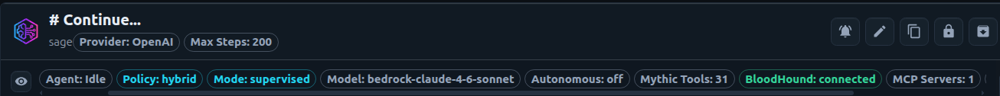

Every Sage session is created through Mythic's **New AI Chat** dialog. Channel creation and the
bot-token decision are covered in [Chat channel configuration](/guides/chat-config); this page is
the day-to-day operating manual. Mythic renders
Sage output as markdown, and shows each tool execution as an updating, collapsible card.

## Pick a mode

Set `mode` when you create the channel, or switch it live with `/mode` (no argument reports the
current mode). Start in `conversation`, which is read-only; move to `supervised` when you want
Sage to propose actions you approve one at a time. `auto` is experimental: use it only for
research and evaluation against a prepared, scoped objective in a lab. What each mode permits is
defined in [Authority modes](/understand/authority-modes).

## Reading the chips

Each Sage channel shows a row of status chips above the transcript. They report the channel's
live configuration and connection state without a model call:

| Chip | What it tells you |
|---|---|
| Provider | Which model provider this channel uses. |
| Max Steps | The cap on model steps for each chat request (default 200, `0` means unlimited). The count starts again with every new request, and approving a card continues the budget of the request it belongs to. It halts a runaway loop. |
| Channel | The Mythic chat channel ID, which matches the thread keys in Sage's log. |
| Agent | The specialist currently executing your request, or `Idle`. |
| Policy | How Sage selects its next move. `hybrid` (the default) asks the model to choose only at real branches of an otherwise deterministic plan; `symbolic` always takes the first admissible action and cannot interpret Respond guidance; `llm` asks the model on every nonempty frontier. |
| Model | The model this chat is actually using. Click it to run `/model`, which shows or changes it; see [Choose and change a model](/guides/models). |
| Mode | The authority mode in force. Click it to run `/mode`. |
| Autonomous | Whether deterministic multi-hop solving is forced for this session. |
| Mythic Tools | How many Mythic tools the channel's bot token can invoke, after scope checks. |
| BloodHound | What BloodHound can do on this turn: `not configured` (no URL or token set), `unavailable` (configured but not connected, or BloodHound CE did not answer a read), `degraded` (graph reads work, ingest does not), or `connected`. `unavailable` and `degraded` show as warnings. Hover over the chip for the reason, and click it to run `/bloodhound`. |
| MCP Servers, MCP Tools | How many MCP servers are connected and how many tools they provide. Click MCP Servers to run `/mcp`. |
| Rounds | How many rounds the current session has run. |

You set provider, model, mode, policy, Max Steps, and credentials in the channel configuration
(the pencil icon on the channel header). Prefer storing the API key as a Mythic user secret
rather than in the channel config, which stores it in plaintext. Changing the model or the OpenAI
settings continues the same conversation; changing the API key, provider, or endpoint starts a new
one. See [Choose and change a model](/guides/models).

<Frame caption="The header of a supervised Sage channel (captured November 2026). Provider and Max Steps sit beside the channel description; the chip row below scrolls sideways when it is wider than the window, which hides the MCP Tools and Rounds chips here.">
  
</Frame>

## Approving guarded actions

In `supervised`, every guarded action (issuing a command, executing a capability, creating a
payload, adding a credential) pauses as a native Mythic approval card before it runs. Approval is
**default-deny**: only an explicit Accept lets it through. Read-only tools (`list_*`, `get_*`,
downloads) never prompt, and neither does staging a tool binary into Mythic's file store; the task
that runs that binary still does.

Each specialist step carries at most one guarded action. When a step ends at its action or at one of
its limits, the Supervisor chooses the next step, and the next guarded action arrives as a new card.
See [Bounded supervised steps](/understand/authority-modes#bounded-supervised-steps).

When the card shows a direct Mythic task proposal, it displays the deterministically prepared
command and arguments. If the command schema or selected registered file changes before issuance,
Sage stops and requires a fresh proposal.

If an accepted task has not returned a confirmed result by the wait deadline, the request ends
with the exact Mythic task ID and an incomplete-observation notice. The task's outcome is still
unknown; Sage does not silently re-issue it. A fresh request can inspect that task's output before
you decide whether to approve another action. A task can also end the wait while Mythic still shows
a settling status such as `Completion Function Running...`; Sage then names that status and says
that credentials or files the completion function registers may not be in Mythic yet.

## After Sage restarts

A chat continues after a Sage restart. On your next message Sage restores the conversation, its
`/mode` override, and its engagement binding, and posts
`Sage restarted; this channel's conversation was restored from its saved session.` A request the
restart interrupted is settled when Mythic sends Sage its startup message:

- An approval card that was still waiting stays open; answer it as usual.
- If you answered a card while Sage was down, Sage adds a **Continue saved decision / Stop** card to
  the same request. **Continue** applies your decision exactly as you made it; **Stop** discards it.
- Any other open request is closed with a notice, and nothing from it is resent.

<Frame caption="Sage restarted while this request waited for approval, and the operator approved the process-listing task in the meantime. Sage asks before it applies that decision: Continue runs the approved action once, and Stop runs nothing.">
  
</Frame>

Sage never resends an approved action that the restart interrupted. If Mythic accepts no new
message in the channel, the request is still open: use Cancel on it in Mythic. The full rules,
including when a chat still needs a fresh channel, are in
[What a restart does to your chats](/configuration/runtime-state#what-a-restart-does-to-your-chats).

## Stopping a run

Two controls stop work, at different layers:

- **The composer stop button.** While Sage is streaming a response, the composer area shows an
  "AI response in progress" banner with a stop button to the right of where you type. Use it to
  cancel the in-flight request.
- **`/stop`.** Cooperatively stops the agent running on the channel. Use it when Sage is mid-run
  and you want the agent itself to halt cleanly.

The autonomous controller also enforces its own hard stop-losses (a cycle cap, wall clock, token
budget, and no-progress loop-breaker), independent of your Max Steps setting.

## What you can see

- `/state` shows the [Engagement State Ledger](/guides/engagement-ledger), the durable record of
  achieved and pending gains shared across chats in the same Mythic operation.
- `/tools` lists the public Mythic tool inventory without a model call, distinguishing read-only
  tools from guarded actions. `/tools staged` lists the binaries in Sage's
  [tool drop zone](/reference/tools-and-capabilities#tool-drop-zone).
- `/report` shows retained identity and membership observations and suggested next checks.

In supervised mode, Sage also checks the Supervisor's closing against the steps it recorded for the
request:

- When a step ran a catalog procedure that ended `partial`, `blocked`, or `failed`, and no later step
  in the request achieved it, the closing starts with a **Sage verification:** line. It names the
  capability and target, the Mythic tasks, the verdict, the effects recorded and not confirmed, and
  the Mythic status of any task that did not finish successfully, read from Mythic by Sage.
- A step that Sage refused before Mythic created a task appears on a `Not issued` line, and the task
  list names only tasks Mythic created.
- A closing that imitates one of Sage's own step reports when no step ran is withheld and replaced
  with `Sage has no completed step recorded for this request, so it cannot report an execution
  result.` A plain answer that claims no step, such as an explanation or a graph fact, reaches you
  unchanged.

The full command list is in the [Slash commands reference](/reference/slash-commands).
