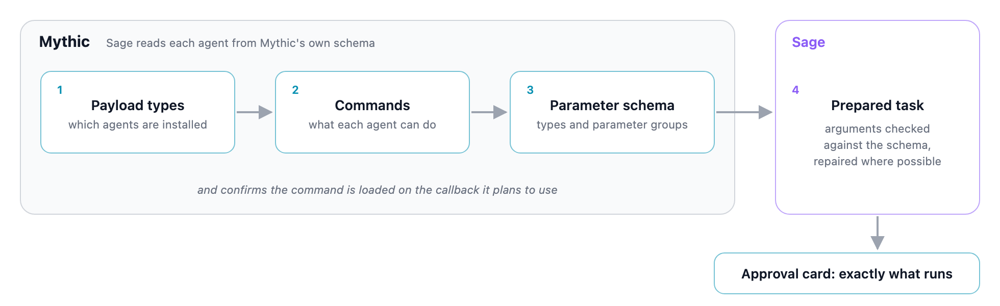
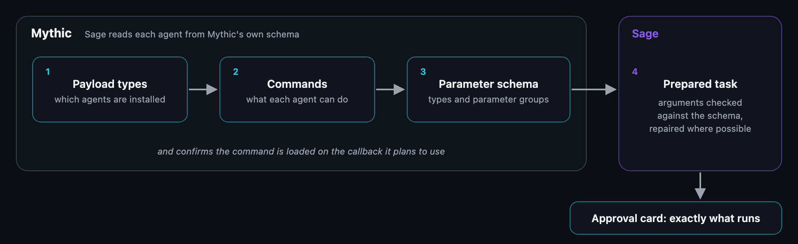

## Works with any Mythic agent

Sage is built to drive any Mythic payload type, not one agent wrapped in a tool layer. It does not
carry a hardcoded command list for any agent. It learns each agent's interface from Mythic itself,
at runtime:

<Steps>
  <Step title="Find the installed payload types">
    `get_payload_names` and `get_all_payload_info` list every payload type installed in Mythic.
    `list_callbacks` reports which agent each live callback runs.
  </Step>
  <Step title="List each agent's commands">
    `get_all_command_names_for_payloadtype` and `get_all_commands_for_payloadtype` return the
    commands that payload type advertises. Before tasking, Sage also reads the commands actually
    loaded on the callback it plans to use.
  </Step>
  <Step title="Read each command's argument schema">
    `get_all_command_args_for_payloadtype` returns a command's parameters with their names, types,
    required flags, defaults, allowed choices, and validation patterns, grouped into Mythic's
    mutually exclusive parameter groups so the model picks one tasking form instead of mixing them.
  </Step>
  <Step title="Build a structured task from that schema">
    Before `issue_task_and_waitfor_task_output` sends anything, Sage resolves the proposed
    arguments against the live schema: it maps aliases to each parameter's CLI name, selects the
    parameter group, fills declared defaults, and checks required parameters and allowed choices.
    A task that does not fit comes back to the model as a specific correction instead of a
    rejected Mythic task. In supervised mode, the resolved command is what the approval card shows.
  </Step>
</Steps>

<Frame caption="Schema-driven tasking. Sage reads payload types, commands, and argument schemas from Mythic, checks the proposed task against them, and in supervised mode shows the resolved command on the approval card. This path works for any agent; packaged capabilities additionally need a payload adapter.">
  
  
</Frame>

Tradecraft follows the same rule: `get_ttp_guidance` tailors a TTP's arguments and examples to how
the target callback's agent runs the tool.

### Payload adapters

On top of that agent-agnostic path, Sage ships small per-payload adapters that capture lessons
learned from running Sage with specific agents. They are polish, not a requirement: an agent without
an adapter is still tasked through the discovery path above.

| Payload type | Adapter |
|---|---|
| Apollo | Yes. Apollo `v0.1.0-rc1` is the last live-validated payload (0.1.0-beta); see [Limitations](/understand/limitations). |
| Merlin | Yes, including graph collection. Not validated. |

The adapters matter most for the [capability layer](#the-capability-layer), whose packaged
attack-chain steps encode payload-specific command forms. Automated graph collection
(`collect-graph`) runs only on footholds with an adapter. You can still run SharpHound on any agent
through ordinary tasking and ingest the result with `ingest_collection`.

## Tools

Every tool the Sage agents can call is **read-only**, **guarded**, or **staging**. Read-only tools
never prompt for approval and cannot change target state. Guarded tools are approval-gated in
supervised mode and denied in conversation mode, and only they can change target state. The one
staging tool, `ensure_tool_uploaded`, writes only Mythic's operation file store and reaches no
callback: it needs no approval in supervised mode and is denied in conversation mode. Every tool
carries its classification in source, CI fails if one is missing, and an unclassified method
defaults to guarded at runtime.

Sage also checks each guarded or staging tool that calls Mythic against a preflight scope on your
channel token, and disables the tool up front when the scope is missing rather than letting it fail
mid-run. Tools that run locally and make no Mythic call (`sandbox_exec`, `download_tool`) have no
preflight scope; approval still applies to them. The Mythic API calls behind a tool can need other
scopes, including read scopes for read-only tools; see
[Minimum bot token scopes](#minimum-bot-token-scopes) for the full set.

| Tool | What it does | Class | Preflight scope |
|---|---|---|---|
| `get_payload_names` | List all installed payload type names | Read-only | None |
| `get_all_payload_info` | Information about all installed payload types | Read-only | None |
| `get_all_command_names_for_payloadtype` | Command names for a payload type | Read-only | None |
| `get_all_commands_for_payloadtype` | All commands for a payload type, with parameters and requirements | Read-only | None |
| `get_all_command_args_for_payloadtype` | One command's argument schema, grouped by parameter group | Read-only | None |
| `list_callbacks` | Per-callback status and liveness for every active callback | Read-only | None |
| `get_task_history_for_callback` | A callback's full task history as JSON | Read-only | None |
| `get_all_task_output_by_task_id` | All output for a Mythic task ID | Read-only | None |
| `issue_task_and_waitfor_task_output` | Issue a command on a callback and wait for its output | Guarded | `task.write` |
| `wait_for_seconds` | Bounded Sage-side pause, with no tasking | Read-only | None |
| `list_open_artifacts` | Artifacts this run created that are not yet cleaned up | Read-only | None |
| `get_operations` | List all Mythic operations | Read-only | None |
| `get_all_uploaded_files` | List all files uploaded to Mythic | Read-only | None |
| `upload_file_by_file_uuid` | Upload a Mythic-stored file to a callback through the agent's upload command | Guarded | `task.write` |
| `list_staged_tools` | List the binaries in the drop zone, or every variant of one tool: type, architecture, matching TTPs, and Mythic presence | Read-only | None |
| `ensure_tool_uploaded` | Ensure a tool binary is in Mythic's file store, uploading it from the drop zone if missing | Staging | `file.write` |
| `download_tool` | Fetch a tool binary from its pinned, sha256-verified TTP source into the drop zone | Guarded | None (local only) |
| `read_credentials` | Read the operation's Mythic credential store (can expose raw secrets) | Read-only | None |
| `add_credential` | Add a credential to the operation's Mythic credential store | Guarded | `credential.write` |
| `get_ttp_guidance` | Match a plain-language goal to the TTP library, tailored to the callback's agent | Read-only | None |
| `get_ttp_full_reference` | The full reference section for a TTP | Read-only | None |
| `list_ttp_categories` | The TTP library grouped by category | Read-only | None |
| `build_capability_commands` | Build the Mythic parameters for a capability action without running it | Read-only | None |
| `execute_capability` | Run one capability action, verify it, and record only proven effects | Guarded | `task.write` |
| `ingest_collection` | Ingest a SharpHound or AzureHound collection into BloodHound | Guarded | `file.read` |
| `read_engagement_state` | Read [Engagement State Ledger](/guides/engagement-ledger) rows by number or page | Read-only | None |
| `submit_engagement_evidence` | Send up to 20 Mythic task, `cred:<id>`, or `file:<id>` citations to the verifiers `/state reconcile` uses; the model never writes rows itself | Read-only | None |
| `get_all_payloads` | Information about all built payloads | Read-only | None |
| `get_c2_profiles_for_payload` | C2 profiles available for a payload type | Read-only | None |
| `get_callback_c2_config` | Configured C2 parameter values for a live callback | Read-only | None |
| `get_payload_c2_config` | Configured C2 parameter values for a built payload | Read-only | None |
| `create_payload` | Create a new Mythic payload | Guarded | `payload.write` |
| `download_payload` | Download a built payload for reuse; returns a Mythic file reference | Read-only | None |
| `delete_payload` | Soft-delete a payload after verifying it has no callbacks | Guarded | `payload.write` |
| `sandbox_exec` | Run untrusted code in an isolated, ephemeral sandbox container | Guarded | None (local only) |

Each agent receives only its share of this list: the Mythic Operator handles callbacks, tasking,
files, staged tools, credentials, tradecraft, capabilities, and the two ledger tools; the Mythic
Payload agent handles payloads and C2 profiles; and the Sandbox agent holds `sandbox_exec`. The
discovery tools are available to both Mythic agents. The Supervisor can call the two ledger tools
in every mode, and `list_callbacks` in conversation and supervised mode. Type `/tools` in chat for
the current list; it is deterministic and makes no model call.

BloodHound graph tools come from the external BloodHound MCP server, not from Sage's own code. See
[BloodHound](/guides/bloodhound) and [MCP servers](/guides/mcp-servers).

## Minimum bot token scopes

Sage acts with the scopes of the API token you attach to the chat channel. For each session it
mints a token from that channel token, and the minted token inherits exactly the channel token's
scopes, so the channel token is the whole permission boundary. In Mythic, a `.write` scope
includes its `.read` scope, and a token can only grant scopes it already holds. See Mythic's
[API tokens](https://docs.mythic-c2.net/version-4.0/operational-pieces/api-tokens) documentation
for how to create a scoped token; the full scope catalog is in
[`scopes.go`](https://github.com/its-a-feature/Mythic/blob/a9add7f1f62f5b2098d1f0eb0306c4b15b8cd916/mythic-docker/src/authentication/mythicjwt/scopes.go).

Sage declares the full set it uses: `chat-ai.write`, `apitoken.write`, `callback.read`,
`response.read`, `operation.read`, `operator.read`, `task.write`, `file.write`, `payload.write`,
`credential.write`, and `eventlog.write`. Mythic does not enforce that list. A narrower token still
runs, with the tools whose scopes it lacks switched off and the reads it lacks returning nothing.

### Baseline

`chat-ai.write` and `apitoken.write` are hard requirements: Mythic requires both on any AI channel
token, and without them Sage cannot answer in the channel. The read scopes back the read-only
tools. A missing read scope does not raise an error: Mythic filters those records out, so Sage sees
no callbacks, no task output, or no files.

| Scope | Why Sage needs it |
|---|---|
| `chat-ai.write` | Post responses to the chat channel. |
| `apitoken.write` | Mint the per-session token from the channel token. |
| `callback.read` | List callbacks, read their loaded commands and C2 configuration. |
| `payload.read` | Resolve each callback's payload type, and read built payloads and their C2 configuration. Without it, Sage cannot tell which agent a callback runs. |
| `task.read` | Read task history. |
| `response.read` | Read task output. |
| `operation.read` | Read the Mythic operation. |
| `operator.read` | Read which operator issued each task, which ledger reconciliation and operation memory record. |
| `eventlog.write` | Store and read the marker in the operation's event log that identifies its [Engagement State Ledger](/guides/engagement-ledger). Without it, Sage cannot create that marker, and the ledger is unavailable in an operation that does not have one yet. |
| `file.read` | List and download files in Mythic's file store. It is Sage's preflight gate for `ingest_collection`, which downloads collections this way, and `list_staged_tools` uses it to check whether Mythic already holds a staged binary. |

Payload type, command, and command-parameter metadata need no scope, so the discovery tools work
with any token.

### Required for the guarded tools you want

| Scope | Enables |
|---|---|
| `task.write` | Creating any Mythic task: `issue_task_and_waitfor_task_output`, `upload_file_by_file_uuid`, and the tasks `execute_capability` issues. Mythic requires it, and it is Sage's preflight gate for those tools; without it, Sage disables them. |
| `file.write` | Registering files in Mythic: `ensure_tool_uploaded`, and capability steps that stage inputs. It is Sage's gate for `ensure_tool_uploaded`. |
| `credential.write` | `add_credential`, and recording credentials a capability harvests. Includes `credential.read`. |
| `credential.read` | `read_credentials`, if you do not grant `credential.write`. Leave both out to keep Sage away from the credential store. |
| `payload.write` | `create_payload` and `delete_payload`. |

No Sage tool uses `callback.write`. Builds before `v0.3.0` gated tasking, `ingest_collection`, and
`sandbox_exec` on it.

### Example sets

| Use | Scopes |
|---|---|
| Observe only, no tasking | `chat-ai.write`, `apitoken.write`, `callback.read`, `payload.read`, `task.read`, `response.read`, `operation.read`, `operator.read`, `eventlog.write`, `file.read` |
| Task callbacks and run capabilities | `chat-ai.write`, `apitoken.write`, `callback.read`, `payload.read`, `task.write`, `response.read`, `operation.read`, `operator.read`, `eventlog.write`, `file.write`, `credential.write` |
| Everything Sage can do | The tasking set plus `payload.write`, which matches the set Sage declares |

`task.write` includes `task.read`, `file.write` includes `file.read`, and `payload.write` includes
`payload.read`, so the larger sets omit those reads. This mapping is derived from the Sage source
and Mythic v4's scope handling. A write call missing its scope fails with a Mythic `missing_scope`
error; a missing read scope returns empty results instead.

## The capability layer

On top of the tools sits a typed capability layer: actions with preconditions, effects, and
structured verifiers that the planner chains from observed state. It models an attack chain
generically (collect graph, escalate through controlled execution, extend rights, harvest
credentials, forge tickets), and each step advances only on verified proof of the previous one.
Nothing is recorded on assertion alone, and no benchmark-specific paths are baked into the product.

Sage derives candidate capabilities at runtime from observed BloodHound and Mythic state, so the
set the planner offers at any moment is the subset whose preconditions currently hold.
`execute_capability` runs one action and records its effect to the Engagement State Ledger only when the
capability's verifier accepts the proof; `build_capability_commands` shows the Mythic parameters an
action would use without running it.

### The 15 capabilities

The catalog describes each capability by the effect it gains, what it needs first, and when to
pick it over its neighbours. When the Supervisor scopes a supervised step to a capability, the
delegation tool lists the catalog generated from these entries, and a name that is not a catalog
capability is refused.

| Capability | Gains | Needs |
|---|---|---|
| `collect-graph` | A BloodHound attack-path graph (paths, ACLs, group and GPO membership) for the collected technology. Runs SharpHound for Active Directory. | A live foothold with valid credentials for the technology being collected. |
| `gpo-controlled-system-exec` | SYSTEM execution on machines in a GPO's scope. | Graph-proven write over a GPO that applies to the target, and a live foothold in the domain. |
| `grant-directory-rights` | Directory replication (DCSync) rights for a principal in the domain. | Rights to add the replication rights, such as Domain Admins or Enterprise Admins. |
| `dcsync-krbtgt` | The domain's krbtgt key, the input to `forge-golden-ticket` and `ensure-kerberos-context`. | Replication rights in the domain. |
| `dcsync-account` | One named account's credential. | Replication rights in the domain. |
| `forge-golden-ticket` | Domain-admin Kerberos authority for the domain. | The domain's krbtgt key. |
| `ensure-kerberos-context` | A callback operating with domain-wide authority, built from krbtgt or golden-ticket material. | The domain's krbtgt key plus proven domain authority, and a live callback. |
| `ensure-account-kerberos-context` | A callback operating as one named account, built from that account's own key. | That account's credential and a live callback. |
| `read-managed-local-admin-secret` | A host's managed (LAPS) local administrator secret. | The right Kerberos account context and a graph-proven read path to the secret. |
| `use-managed-local-admin-secret` | Local administrator on a host through its managed secret. | That host's managed secret and a live callback. |
| `execute-as-local-admin` | A live execution context on a host where you already hold local administrator. | Local administrator on the host and a live callback. |
| `endpoint-protection-adjustment` | A bounded Microsoft Defender change (real-time protection off, or a path exclusion) that unblocks execution. | Remote execution and local administrator on the host, and a live callback. |
| `adcs-ca-private-key-export` | The ADCS CA private key. | Remote execution and local administrator on the CA host, and a live callback. |
| `adcs-esc-certificate-enroll` | An account certificate enrolled through a vulnerable ADCS template. | A CA private-key export that failed because the key is not exportable, and a live callback. |
| `adcs-certificate-auth` | Domain control by authenticating with certificate material. | The CA key or an enrolled certificate, and a live callback. |

## Extension points

Three parts of Sage are plain files in the Sage repository, meant for you to edit rather than
rebuild:

- **Agent prompts.** Each agent's system prompt is a markdown file in
  `Payload_Type/sage/prompts/`, one per agent from `supervisor.md` to `sandbox.md`. Edit a file
  and start a new chat: each new session re-reads every prompt, so your change takes effect
  without a restart. A restart is only needed for code changes. This is how you ship your own
  playbook with an engagement.
- **The TTP library.** `Payload_Type/sage/ttps/` holds over two hundred markdown tradecraft
  files covering Active Directory attack paths, ADCS abuse, ACL chains, and failure triage,
  among others. The agents plan from this library; editing it tunes what Sage knows.
- **The tool drop zone.** Covered below: `Payload_Type/sage/tools/` stages operator-supplied
  binaries into Mythic on demand.

## Tool drop zone

`Payload_Type/sage/tools/` is an operator drop zone for tool binaries. It ships **empty**. Sage
bundles no offensive binaries, and a local image build does not bake the folder's contents into the
image. Drop a binary in (for example `Rubeus.exe` or `SharpHound.exe`) and Sage can see it through
`list_staged_tools`, then stage it into Mythic on demand with `ensure_tool_uploaded`, so you do not
have to upload it by hand. `/tools staged` shows the same inventory in chat.

The inventory reads only the top level of the folder and skips dotfiles, symlinks, and subfolders.
For each file it reports:

- the sha256, and the type (.NET assembly, native executable, BOF, script, or archive) and
  architecture, read from the file header rather than the name; header parsing never runs the file;
- the TTPs that document it. Renamed and per-architecture builds match their tool, so
  `new_sharphound_x64.exe` and `SharpHound.o` are listed as SharpHound variants;
- whether Mythic's file store already holds the same bytes, which needs `file.read`. When it does,
  Sage uses that file and does not stage it again.

A binary that no TTP documents is listed with a hint that tells Sage to ask you what it is for
before using it. When Sage looks for a tool that is in neither the folder nor Mythic, it asks you
to add it. Staging a file never authorizes running it: uploading it to a callback and tasking stay
guarded. `download_tool` can also fetch a pinned, sha256-verified binary from its TTP source into
this folder, with your approval.
