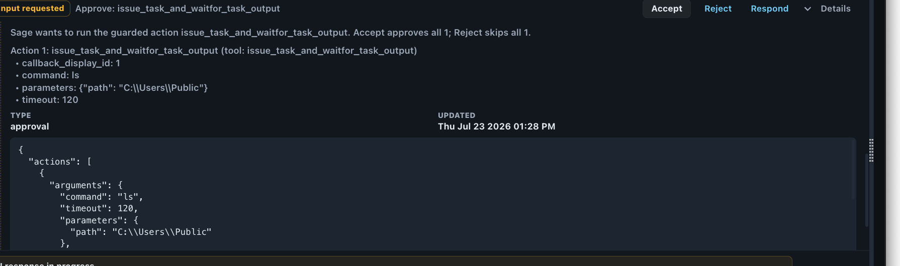

Every Sage chat channel runs in one of three authority modes. The mode determines what Sage is
allowed to change, not just what it can see.

## The modes

| Mode | What Sage can do | When to use |
|---|---|---|
| `conversation` (default) | Reads Mythic and BloodHound state, queries read-only tools, and answers. Cannot fire a guarded/offensive action, even with Autonomous Solve on; the model is not even offered the guarded tools. | Asking questions, reviewing the graph, getting tradecraft advice, planning. The safe default. |
| `supervised` | Proposes guarded actions; each one waits for your approval before it runs. | Interactive engagement work where you want Sage to act but keep a hand on every trigger. |
| `auto` (experimental) | Runs the autonomous observe → select → execute → verify loop with no per-action approval. Exercised only against the GOAD lab. | Research and evaluation against a prepared lab objective with a live callback and an ingested graph. |

The New AI Chat dialog labels these Conversation, Supervised, and Autonomous; Autonomous is `auto`.
Set the mode when you create the channel, or switch it live with `/mode` (no argument reports the
current mode).

## Assisted mode is not a fourth mode

The assisted product covers `conversation` and `supervised` together. It is not a separately
selectable runtime mode: `conversation` observes and answers without guarded activity, and
`supervised` executes only the exact guarded action you accept.

## Supervised approvals

In supervised mode every **guarded** action (issuing a command, executing a capability, creating
a payload, adding a credential) pauses as a native Mythic approval request before it runs. This
is human-in-the-loop (HITL) execution: Sage proposes, and you decide. Approval is default-deny,
and the card gives you three responses: **Accept** approves exactly the prepared action,
**Reject** skips it, and **Respond** answers with your own instructions, which Sage incorporates
before acting again. Read-only tools never prompt.

<Frame caption="A guarded action waiting on your decision in a supervised channel (Sage beta, captured July 2026).">
  
</Frame>

Guarded tools are scope-preflighted: each that calls Mythic requires a bot-token scope
(`task.write`, `payload.write`, `credential.write`, `file.write`, or `file.read`), and a tool whose
scope your channel token lacks is disabled up front rather than failing mid-run. See
[Minimum bot token scopes](/reference/tools-and-capabilities#minimum-bot-token-scopes) for the
full set a token needs.

One tool sits between the classes. Staging a tool binary into Mythic's file store
(`ensure_tool_uploaded`) shows no approval card in supervised mode, because it writes only Mythic's
operation file store and reaches no callback. The task that later runs that binary on a target
still needs its own approval, and staging stays unavailable in conversation mode.

## Bounded supervised steps

In supervised mode the Supervisor works through specialists one step at a time, and Sage bounds
each step. A step returns control to the Supervisor after its one guarded action has run or been
rejected, or earlier when it reaches a limit:

| Limit | Shipped value | Where it is set |
|---|---|---|
| Tool calls in one step | 20 | `tool_calls`, or `SAGE_STEP_MAX_TOOL_CALLS` |
| Active time in one step | 600 seconds | `active_seconds`, or `SAGE_STEP_MAX_ACTIVE_SECONDS` |
| Consecutive tool errors | 3 | `consecutive_errors`, or `SAGE_STEP_MAX_CONSECUTIVE_ERRORS` |

Each specialist declares its own limits in the `step_bounds:` header of its
[prompt file](/configuration/edit-files-from-mythic#edit-an-agent-prompt), and every specialist
ships with the values above. A valid `SAGE_STEP_MAX_*` value in the
[container environment](/configuration/environment#container-wide-settings) overrides that limit
for every specialist. Every model call in a step carries a line from Sage with the tool calls and
active time the step has left, and a batch of parallel tool calls runs only as many calls as the
step has left; the rest are removed before anything runs.

Time spent waiting on your approval, and time inside the guarded action itself (including the
Mythic task wait), never counts as active time. After its action the specialist may still read and
summarize the result, but a second guarded proposal in the same step is removed before any approval
card appears and needs a new step. A proposal that falls outside the step's scope is also removed
before any card; the step outcome names it, and if the request ends there, the closing lists it as
neither approved nor executed.

When a step reaches a limit, the specialist gets one last model call with no tools offered, for at
most 30 seconds, so it can report what it found, and Sage passes that answer to the Supervisor
unchanged. If the call returns no text, fails, runs out of time, or returns an answer that
supervised filtering would alter, Sage sends a notice saying so instead, and nothing more runs in
that step. The step still ends at its limit, and its partial answer never counts as a finished
answer. Reaching a limit is not a failure, and returning control never cancels a task on the
target.

Before a delegation to the Mythic Operator starts, Sage checks its brief: the callback must be one
Sage has observed, targets must be named by you or already known to Sage, and any task or credential
it references must be a record Sage holds. A failed check goes back to the Supervisor with the
reasons, and a second consecutive failure ends the request and tells you why. When the step ends,
Sage hands the Supervisor a typed outcome (the action ran, was rejected, fell outside the step's
scope, reached a limit, left a task pending, or finished) with the tasks the step issued, read from
Mythic rather than taken from the specialist's summary. These limits do not apply in auto mode or
conversation mode.

### Catalog steps are bound to current evidence

When the Supervisor scopes a step to a [catalog capability](/reference/tools-and-capabilities#the-capability-layer)
other than graph collection, the step must select one of the actions that current evidence
supports. Sage lists those candidates in the Supervisor's ledger view, drawn from the Engagement
State Ledger, the live callbacks it reads from Mythic, the current account contexts, and what the
request has already tried. The approval card then shows exactly the bound action: its procedure,
callback, targets, and inputs. After you accept, and before the executor issues anything, Sage
checks the action against current evidence again, so support withdrawn while the card waited issues
no task. A selection Sage cannot bind ends the request as blocked before any card, and says that
other work remains possible.

<Frame caption="The approval card for a catalog step bound to a DCSync of krbtgt in a lab domain. The action line carries the procedure, its preconditions, the evidence it rests on, and the target; the inputs line carries the callback and account; the planned Mythic task and intended effect follow. Click the image to read it at full size.">
  
</Frame>

Before the first task, the executor also builds the capability's whole command plan and refuses it
if a command still needs an input nothing supplies, such as a Kerberos service-proof host when
BloodHound knows no domain controller for the domain. The refusal names each missing input and what
supplies it, and ends with `No task was issued.` To supply a proof host for a ticket forge or a
Kerberos context step, name the host in your own message, by its full name, its first label, or a
UNC path's host. Sage keeps it only when it lies in the domain that procedure must prove, and the
approval card shows it.

With Autonomous Solve off, you can also name the accounts a DCSync step targets. Put them after
`dcsync` in your message, as `account@domain`, `DOMAIN\account`, or a bare name when only one domain
in scope fits, for example `DCSync alice and bob`. Sage offers each named account as a candidate
when the ledger, replication or admin rights, and a live callback support it. It leaves out krbtgt,
which `dcsync-krbtgt` covers, machine accounts, and groups, and asks you to qualify a bare name that
more than one domain could hold. A request for an account whose credential is already recorded ends
with the ledger row and task that prove it. To prove that account again, for example after a
password change, ask for it explicitly: `DCSync administrator again` or
`Re-verify administrator with DCSync`. The message must contain `dcsync`, and the account counts as
proven only when a task from that request proves it anew.

## Objective-led supervised runs

A supervised channel can also pursue a stated objective across turns. Sage still proposes one
guarded action at a time, and each runs only after you approve its card; objectives and evidence
survive approvals, rejections, and specialist handbacks.

In supervised and conversation mode, before Sage chooses a specialist for a request to reach
privilege on or take control of a target, it reads the BloodHound graph: which domains have been collected and, for each target domain the
graph covers, whether a path exists from the principals Sage controls. The Supervisor receives that
result as context. If BloodHound is down or slow, Sage proceeds and says no graph analysis was
available. When the graph is empty or lacks a domain the objective names, Sage's first proposal is
a `collect-graph` step on the observed callback, once per request, for you to approve or reject.

Turning on **Autonomous Solve** in the channel configuration forces deterministic multi-hop solving
for a supervised session; completion still requires objective evidence. In conversation mode Sage
ignores the toggle, says so once in the chat, and stays read-only. See
[Chat channel configuration](/guides/chat-config).

## Auto is experimental and GOAD-only

Auto pursues an explicitly bound objective without approval of each action. It is a research and
evaluation capability: it has been exercised only against the
[GOAD](https://github.com/Orange-Cyberdefense/GOAD) lab, and each release's GitHub release notes say
whether that release ran it live. That does not establish reliability or generality for other environments, and it is
not a production endorsement. Sage plans from the graph and callbacks in front of it, not from
benchmark-specific strategies baked into the product. Treat auto as a lab capability until a
release says otherwise.
