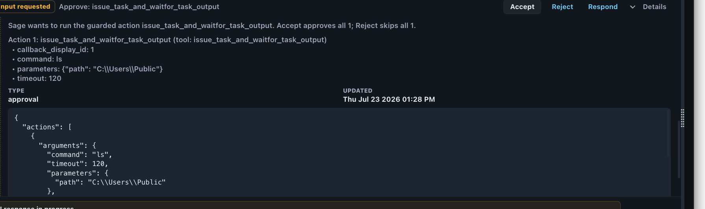

Every Sage chat channel runs in one of three authority modes. The mode determines what Sage is
allowed to change, not just what it can see.

## The modes

| Mode | What Sage can do | When to use |
|---|---|---|
| `conversation` (default) | Reads Mythic and BloodHound state, queries read-only tools, and answers. Cannot fire a guarded/offensive action, even with Autonomous Solve on. | Asking questions, reviewing the graph, getting tradecraft advice, planning. The safe default. |
| `supervised` | Proposes guarded actions; each one waits for your approval before it runs. | Interactive engagement work where you want Sage to act but keep a hand on every trigger. |
| `auto` (experimental) | Runs the autonomous observe → select → execute → verify loop with no per-action approval. Exercised only against the GOAD lab. | Research and evaluation against a prepared lab objective with a live callback and an ingested graph. |

The New AI Chat dialog labels these Conversation, Supervised, and Autonomous; Autonomous is `auto`.
Set the mode when you create the channel, or switch it live with `/mode` (no argument reports the
current mode).

## Assisted mode is not a fourth mode

The assisted product covers `conversation` and `supervised` together. It is not a separately
selectable runtime mode: `conversation` observes and answers without guarded activity, and
`supervised` executes only the exact guarded action you accept.

## Supervised approvals

In supervised mode every **guarded** action (issuing a command, executing a capability, creating
a payload, adding a credential) pauses as a native Mythic approval request before it runs. This
is human-in-the-loop (HITL) execution: Sage proposes, and you decide. Approval is default-deny,
and the card gives you three responses: **Accept** approves exactly the prepared action,
**Reject** skips it, and **Respond** answers with your own instructions, which Sage incorporates
before acting again. Read-only tools never prompt.

<Frame caption="A guarded action waiting on your decision in a supervised channel (Sage beta, captured July 2026).">
  
</Frame>

Guarded tools are scope-preflighted: each that calls Mythic requires a bot-token scope
(`task.write`, `payload.write`, `credential.write`, `file.write`, or `file.read`), and a tool whose
scope your channel token lacks is disabled up front rather than failing mid-run. See
[Minimum bot token scopes](/reference/tools-and-capabilities#minimum-bot-token-scopes) for the
full set a token needs.

One tool sits between the classes. Staging a tool binary into Mythic's file store
(`ensure_tool_uploaded`) shows no approval card in supervised mode, because it writes only Mythic's
operation file store and reaches no callback. The task that later runs that binary on a target
still needs its own approval, and staging stays unavailable in conversation mode.

## Bounded supervised steps

In supervised mode the Supervisor works through specialists one step at a time, and Sage bounds
each step. A step returns control to the Supervisor after its one guarded action has run or been
rejected, or earlier when it reaches a limit:

| Limit | Default | Setting |
|---|---|---|
| Tool calls in one step | 20 | `SAGE_STEP_MAX_TOOL_CALLS` |
| Active time in one step | 600 seconds | `SAGE_STEP_MAX_ACTIVE_SECONDS` |
| Consecutive tool errors | 3 | `SAGE_STEP_MAX_CONSECUTIVE_ERRORS` |

Time spent waiting on your approval, and time inside the guarded action itself (including the
Mythic task wait), never counts as active time. After its action the specialist may still read and
summarize the result, but a second guarded proposal in the same step is removed before any approval
card appears and needs a new step. Reaching a limit is not a failure, and returning control never
cancels a task on the target.

Before a delegation to the Mythic Operator starts, Sage checks its brief: the callback must be one
Sage has observed, targets must be named by you or already known to Sage, and any task or credential
it references must be a record Sage holds. A failed check goes back to the Supervisor with the
reasons, and a second consecutive failure ends the request and tells you why. When the step ends,
Sage hands the Supervisor a typed outcome (the action ran, was rejected, fell outside the step's
scope, reached a limit, left a task pending, or finished) with the tasks the step issued, read from
Mythic rather than taken from the specialist's summary. These limits do not apply in auto mode or
conversation mode.

## Objective-led supervised runs

A supervised channel can also pursue a stated objective across turns. Sage still proposes one
guarded action at a time, and each runs only after you approve its card; objectives and evidence
survive approvals, rejections, and specialist handbacks.

In supervised and conversation mode, before Sage chooses a specialist for a request to reach
privilege on or take control of a target, it reads the BloodHound graph: which domains have been collected and, for each target domain the
graph covers, whether a path exists from the principals Sage controls. The Supervisor receives that
result as context. If BloodHound is down or slow, Sage proceeds and says no graph analysis was
available. When the graph is empty or lacks a domain the objective names, Sage's first proposal is
a `collect-graph` step on the observed callback, once per request, for you to approve or reject.

Turning on **Autonomous Solve** in the channel configuration forces deterministic multi-hop solving
for a supervised session; completion still requires objective evidence. In conversation mode Sage
ignores the toggle, says so once in the chat, and stays read-only. See
[Chat channel configuration](/guides/chat-config).

## Auto is experimental and GOAD-only

Auto pursues an explicitly bound objective without approval of each action. It is a research and
evaluation capability: it has been exercised only against the
[GOAD](https://github.com/Orange-Cyberdefense/GOAD) lab on development builds, and it was not run
live on 0.3.0. That does not establish reliability or generality for other environments, and it is
not a production endorsement. Sage plans from the graph and callbacks in front of it, not from
benchmark-specific strategies baked into the product. Treat auto as a lab capability until a
release says otherwise.
